# Meu IP 2.0

**Português** · [English](README.en.md)

Ferramentas de rede grátis, direto no navegador e sem cadastro. É o **meuip.juk.re** reescrito em Next.js, com o layout da família JUK.re e um tom de verde claro.

Descubra seu IP, teste portas, consulte DNS, confira certificados SSL/TLS, busque WHOIS, faça requisições HTTP, localize um IP no mapa e meça latência com ping em tempo real. Tudo isso também está disponível por uma API HTTP simples.

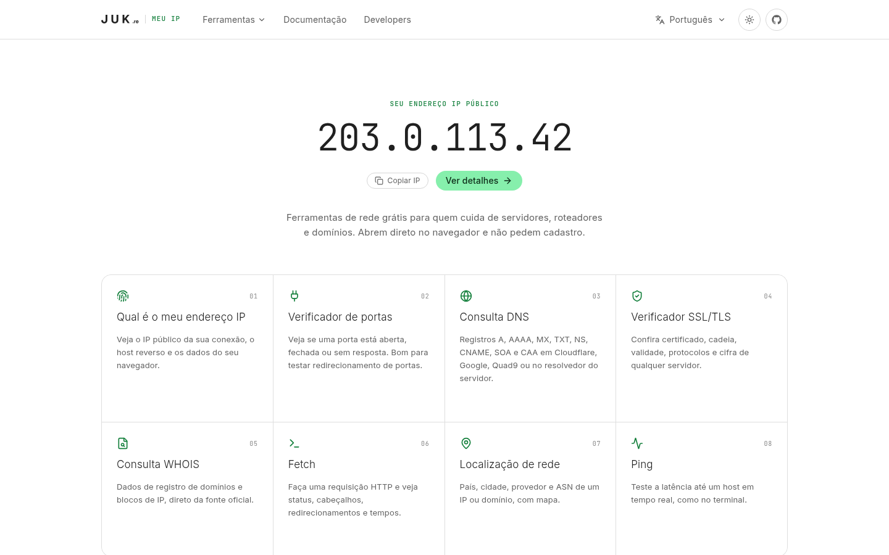

## Ferramentas

| Ferramenta | O que faz |
|---|---|
| **Meu IP** | Mostra o IP público, o host reverso, o provedor e a localização |
| **Verificador de portas** | Diz se uma porta está aberta, fechada ou sem resposta (até 20 por consulta) |
| **Consulta DNS** | A, AAAA, CNAME, MX, NS, TXT, SOA, CAA e SRV, em Cloudflare, Google, Quad9, OpenDNS ou no resolvedor do servidor |
| **Verificador SSL/TLS** | Certificado, cadeia, validade, protocolos aceitos e cifra |
| **Consulta WHOIS** | Domínios e blocos de IP, seguindo as indicações do IANA até o registro oficial (inclui o Registro.br) |
| **Fetch** | Requisição HTTP com cabeçalhos e cookies, redirecionamentos, tempos e corpo da resposta |
| **Localização de rede** | País, cidade, provedor e ASN de um IP ou domínio, com mapa |
| **Ping** | Latência em tempo real, no formato do terminal, com botão de parar |

<table>
  <tr>
    <td>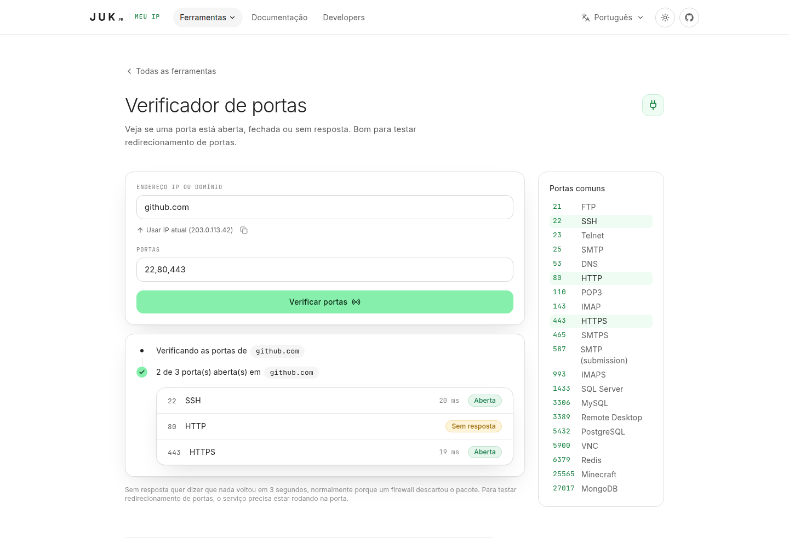</td>
    <td>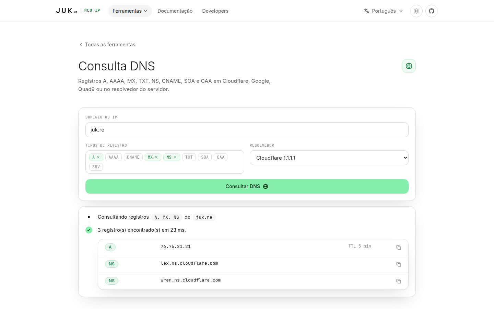</td>
  </tr>
  <tr>
    <td>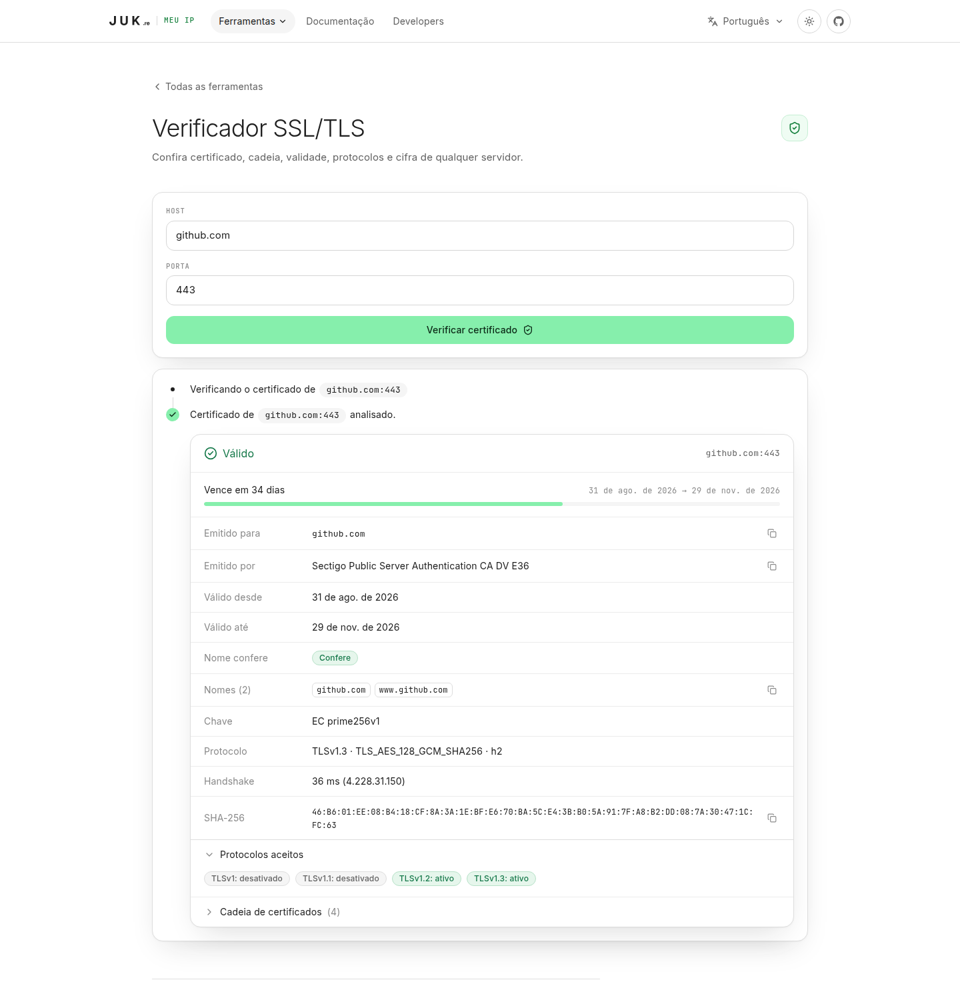</td>
    <td>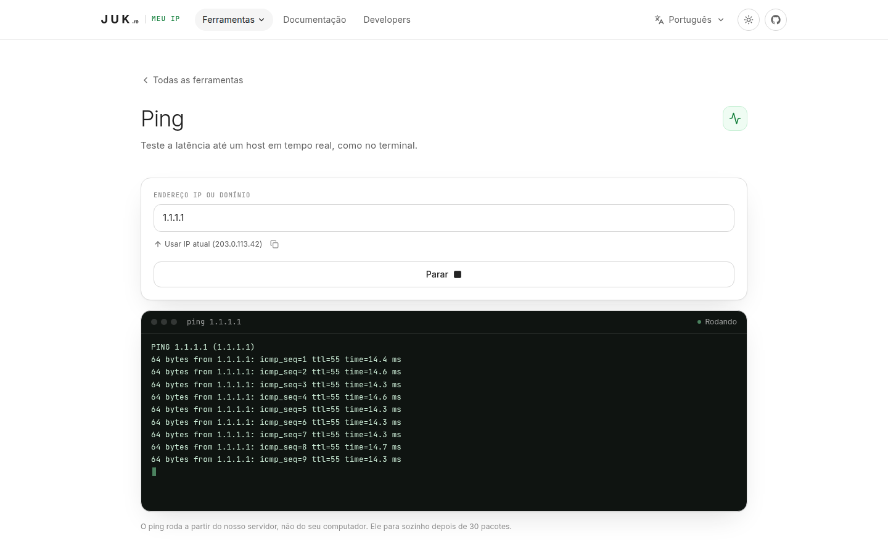</td>
  </tr>
</table>

## Temas e idiomas

O site tem tema claro, escuro e o do sistema, e funciona em **português, inglês, espanhol e francês**. O idioma fica na URL (`/pt`, `/en`, `/es`, `/fr`) e um aviso sugere o idioma do navegador quando ele é diferente do da página.

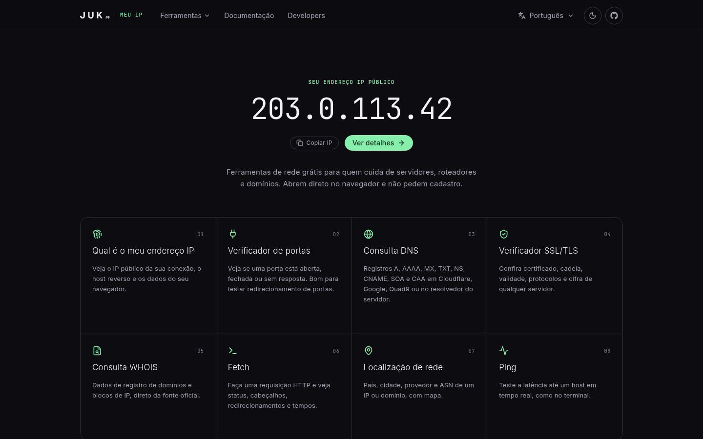

## Documentação e Developers

A **documentação** tem menu lateral, busca com `Ctrl+K`, "Nesta página" e um botão para copiar a página em Markdown. Ela inclui guias (IP público e CGNAT, redirecionamento de portas, DNS, certificados) e a parte para devs: visão geral da API, referência, respostas em tempo real, receitas e limites.

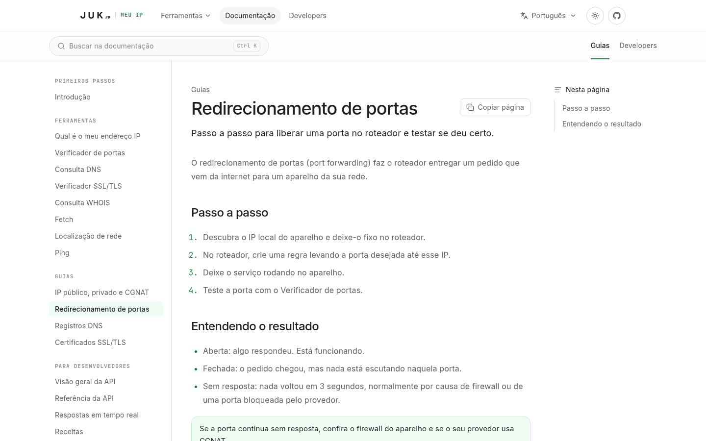

A página **Developers** mostra como usar cada rota em 8 linguagens (cURL, JavaScript, Python, PHP, Go, Ruby, C# e PowerShell), com exemplo de resposta e um botão para executar a chamada. Ela acompanha o tema do site: no claro tem cara de **PowerShell** e no escuro, de **CMD**.

<table>
  <tr>
    <td>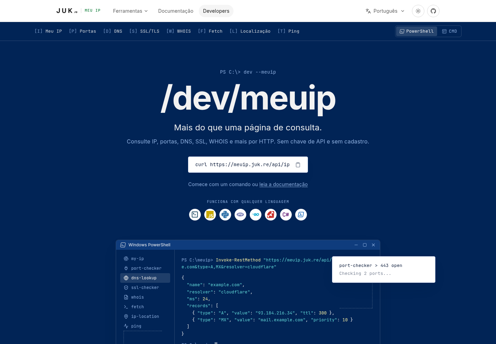</td>
    <td>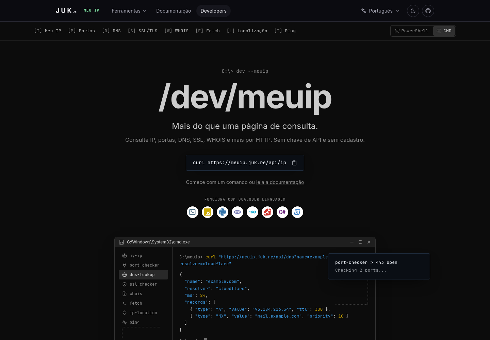</td>
  </tr>
</table>

### No celular

<table>
  <tr>
    <td>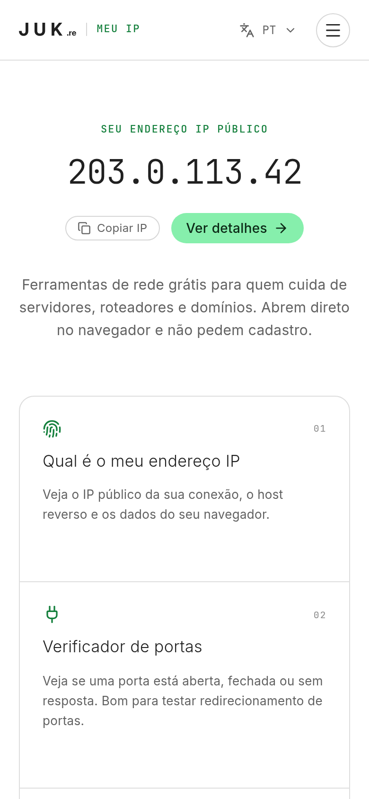</td>
    <td>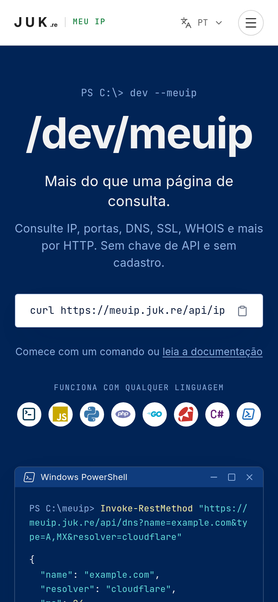</td>
  </tr>
</table>

## Como rodar

Precisa de Node.js 20 ou mais novo.

```bash
npm install
npm run dev     # http://localhost:3000
```

Para produção:

```bash
npm run build
npm start
```

## API

Todas as rotas são `GET`, respondem em JSON (o ping responde em texto, linha a linha) e não pedem chave.

```bash
curl https://meuip.juk.re/api/ip
curl "https://meuip.juk.re/api/dns?name=example.com&type=A,MX"
curl "https://meuip.juk.re/api/ports?host=example.com&ports=80,443"
curl -N "https://meuip.juk.re/api/ping?host=1.1.1.1"
```

O limite é de 30 consultas por minuto por IP. Os erros trazem um campo `error` no idioma do cabeçalho `x-lang` ou `Accept-Language`. A lista completa de rotas está em `/pt/developers` e em `lib/api-docs.ts`.

## Como o projeto é organizado

- `app/[lang]/` é o site, com o idioma na URL. Sem prefixo, o `proxy.ts` redireciona pelo cookie `lang` ou pelo `Accept-Language`.
- `app/api/*/route.ts` tem uma rota por ferramenta, todas via `apiRoute` (`lib/api.ts`): rate limit, JSON e erros traduzidos.
- `lib/net-guard.ts` bloqueia SSRF: toda consulta resolve o host, recusa IPs privados ou reservados e conecta no IP já validado.
- `lib/i18n/dictionaries/*.ts` tem todos os textos da interface. O `pt.ts` define o formato e os outros três seguem o mesmo tipo, então esquecer uma chave dá erro de TypeScript.
- `lib/i18n/docs/*.ts` tem os artigos da documentação.
- `lib/tools.ts` lista as ferramentas. Para criar uma nova, adicione uma entrada aqui, os textos nos dicionários, uma rota em `app/api` e o componente em `components/tools`.
- `components/dev/` e `lib/snippets.ts` montam a página Developers.
- `app/globals.css` guarda o tema (verde claro, escuro e o visual PowerShell/CMD).

SEO: metadados por página com hreflang, Open Graph, dados estruturados, `sitemap.xml`, `robots.txt`, `manifest.webmanifest` e `llms.txt`. Em outro domínio, defina `NEXT_PUBLIC_SITE_URL`.

## Em produção

- O IP do visitante vem de `cf-connecting-ip`, `x-real-ip` ou `x-forwarded-for`. Rode atrás de um proxy que sobrescreva esses cabeçalhos, senão eles podem ser forjados.
- O rate limit fica em memória, por processo. Com várias réplicas, troque por Redis ou algo parecido.
- O ping usa o binário `ping` quando ele existe e, se não existir (por exemplo numa imagem Docker enxuta), mede o tempo de conexão TCP. Atrás de nginx, mantenha o buffering desligado em `/api/ping` (a rota já envia `X-Accel-Buffering: no`).
- A geolocalização usa o ipwho.is. Trocar de provedor mexe só em `app/api/geo/route.ts`.
- O servidor precisa de saída liberada para as portas 43 (WHOIS), 53 (DNS) e portas arbitrárias.

## Capturas de tela

As imagens de `docs/screenshots` são geradas por um script que usa o Chrome em modo headless:

```bash
npm run build && npm start -- -p 3111
CHROME_PATH=/caminho/do/chrome npm run screenshots
```

O script manda o cabeçalho `x-real-ip: 203.0.113.42` (um IP reservado para documentação), então as imagens não mostram o IP de ninguém.

---

© 2026 JUK.re, desenvolvido por [Juca](https://josuejuca.com).
